<p align="center">
  <a href="https://pliffdax.dev">
    
  </a>
</p>

<h3 align="center">Projects, short notes and experiments, kept on a desk.</h3>

<p align="center">
  <a href="https://pliffdax.dev"><b>pliffdax.dev</b></a>
</p>

<p align="center">
  <a href="https://github.com/pliffdax" title="GitHub"><picture><source media="(prefers-color-scheme: dark)" srcset="images/readme/github-dark.svg"></picture>&nbsp;github</a>
  &emsp;
  <a href="https://x.com/alleksa" title="X: @alleksa"><picture><source media="(prefers-color-scheme: dark)" srcset="images/readme/x-dark.svg"></picture>&nbsp;x</a>
  &emsp;
  <a href="https://www.instagram.com/pliffdax1/" title="Instagram: @pliffdax1"><picture><source media="(prefers-color-scheme: dark)" srcset="images/readme/instagram-dark.svg"></picture>&nbsp;instagram</a>
  &emsp;
  <a href="https://open.spotify.com/user/y3h4fft19azfp9es33dbge0mh" title="Spotify: Pliffdax"><picture><source media="(prefers-color-scheme: dark)" srcset="images/readme/spotify-dark.svg"></picture>&nbsp;spotify</a>
  <br><br>
  <a href="https://t.me/Pliffdax" title="Telegram: @Pliffdax"><picture><source media="(prefers-color-scheme: dark)" srcset="images/readme/telegram-dark.svg"></picture>&nbsp;@Pliffdax</a>
  &emsp;
  <a href="https://t.me/pliffdax1" title="Telegram channel: @pliffdax1"><picture><source media="(prefers-color-scheme: dark)" srcset="images/readme/telegram-dark.svg"></picture>&nbsp;channel</a>
  &emsp;
  <picture><source media="(prefers-color-scheme: dark)" srcset="images/readme/discord-dark.svg"></picture>&nbsp;<code>pliffdax</code>
  &emsp;
  <a href="https://discord.gg/cjfdwDsXTK" title="Discord server"><picture><source media="(prefers-color-scheme: dark)" srcset="images/readme/discord-dark.svg"></picture>&nbsp;server</a>
</p>

<br>

> **Now** &nbsp;·&nbsp; setting up this site from an empty README.

<br>

<details>
<summary><b>About this repo</b></summary>

<br>

The source of [pliffdax.dev](https://pliffdax.dev): a static [Astro](https://astro.build) site with no UI framework and no animation library.

**The desk.** The front page is a desk you can rearrange. Cards are dragged with a small hand-written spring loop (they lean into the pull and slide when thrown), the layout is remembered per visitor, and **tidy up** lines everything up.

**Opening a card.** A note or project lifts off the desk and unfolds into a sheet while everything else slides out of view; the folded corner, a click on the empty desk or <kbd>Esc</kbd> puts it back. The paper's flight runs on the Web Animations API, so it stays on the compositor.

**Notes and projects.** `/notes` and `/projects` are the same desk: cards that don't belong fly off, the rest settle into a grid. Every note and project is also a plain static page.

```sh
npm install
npm run dev       # http://localhost:4321
npm run build     # static output in dist/
```

Pull requests run the required Astro checks and build. Merging into `main`
automatically publishes to the VPS. See [deployment and rollback](ops/README.md).

| What | Where |
| --- | --- |
| Notes | `src/content/notes/*.md` |
| Projects | `src/content/projects/*.md` |
| Socials, one file each | `src/content/socials/*.yaml` |
| “Now” and its history | `src/data/now.ts` |
| Default spots on the desk | `src/lib/layout.ts` |
| Desk engine | `src/scripts/desk.js` |

</details>
